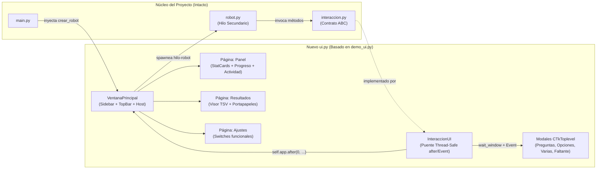

# Plan de Arquitectura y Estrategia de Acople: `demo_ui.py` → `ui.py`

## 1. Diagnóstico Arquitectónico

El proyecto sigue un patrón **Ports & Adapters (Hexagonal)**:
- **Puerto (Contrato):** [`Interaccion`](interaccion.py) define los métodos abstractos que consume [`RobotDigitalizador`](robot.py).
- **Punto de Ensamblaje:** [`main.py`](main.py) importa `VentanaPrincipal` desde [`ui.py`](ui.py) y le inyecta la fábrica `crear_robot(operador, fecha, interaccion)`.
- **Adaptador UI:** [`demo_ui.py`](demo_ui.py) implementa las firmas de `VentanaPrincipal`, `InteraccionUI` y los 4 diálogos modales (`VentanaPreguntas`, `VentanaOpciones`, `VentanaVarias`, `VentanaFaltante`), añadiendo navegación multipágina (`Panel`, `Resultados`, `Ajustes`), tarjetas de métricas (`StatCard`), `Sidebar` colapsable y `TopBar` con píldora de estado.



---

## 2. Mapeo e Inyección de Funciones y Eventos

| Evento / Acción en `ui.py` (Real) | Componente Destino en `demo_ui.py` | Mecanismo de Acople / Ajuste Requerido |
| :--- | :--- | :--- |
| **Inicio de corrida** (`arrancar_robot`) | `self.boton_iniciar` + `<Control-Return>` | Mantener el guard `if self._en_curso: return` de `demo_ui.py` (evita doble ejecución por doble clic o atajo `Ctrl+Enter`). |
| **Validación de fecha** (`parsear_fecha`) | `self.entrada_fecha` + botón `"Hoy"` (`_poner_hoy`) | Si lanza `ErrorCarpeta`, invocar `self.set_estado(str(exc), "error")` que actualiza el punto de color, la píldora superior (`TopBar.pill`), el `label_estado` y el log de actividad. |
| **Lanzamiento del hilo** (`_hilo_robot`) | `threading.Thread(..., name="hilo-robot")` | **Corrección crítica Thread-Safe:** En `demo_ui.py`, el bloque `except` de `_hilo_robot` debe notificar a la UI mediante `self.after(0, ...)` para nunca mutar widgets de Tkinter fuera del hilo principal. |
| **Actualización de estado** (`InteraccionUI.estado`) | `VentanaPrincipal.set_estado(mensaje, nivel)` | Mapea `nivel` (`"ok"`, `"aviso"`, `"error"`, `"info"`) a `COLORES`, actualiza `self.label_estado`, `self._punto_estado`, `self.topbar.pill` y añade una entrada limpia con hora a `self.log_box`. |
| **Avance de progreso** (`InteraccionUI.progreso`) | `VentanaPrincipal.set_progreso(actual, total)` | Reemplaza a `actualizar_progreso()`. Detiene el modo indeterminado, calcula `fraccion`, actualiza `barra_progreso`, `lbl_pct` (`%`) y la tarjeta `self.stat_expedientes.set(f"{actual}/{total}", "procesados")`. |
| **Entrega de resultados TSV** (`InteraccionUI.mostrar_resultado`) | `VentanaPrincipal.mostrar_tsv(tsv, total)` | Reemplaza `VentanaResultado(CTkToplevel)` de `ui.py`: inyecta el TSV en `self.caja_resultado`, actualiza `self.stat_filas`, copia al portapapeles (si el switch de autocopiado está activo) y navega automáticamente a la vista `"resultados"` (`self._navegar("resultados")`). |
| **Cierre de corrida** (`InteraccionUI.terminado`) | `VentanaPrincipal.finalizar(exito)` | Actualiza `self._en_curso = False`, `self.stat_estado`, `self.topbar.pill` y conmuta `self.boton_iniciar` a `"Cerrar robot"` (`self.destroy`) si `exito=True` o revierte a `"▶ Iniciar digitalización"` si `exito=False`. |
| **Popups bloqueantes** (`pedir_datos_manuales`, `elegir_opcion`, `elegir_varias`, `pedir_archivo`, `confirmar`) | `VentanaPreguntas`, `VentanaOpciones`, `VentanaVarias`, `VentanaFaltante`, `messagebox.askyesno` | Se mantienen sincronizados mediante `InteraccionUI._en_hilo_principal(abrir)` usando `threading.Event()` + `self.app.wait_window(popup)`. |

---

## 3. Variables de Estado e Inicializaciones que Deben Mantenerse Intactas

### A. En `VentanaPrincipal`
1. **Firma del constructor:** `__init__(self, crear_robot: Callable[[str, date, Interaccion], object])`. `main.py` lo instancia como `VentanaPrincipal(crear_robot)`.
2. **Inyección de operador vacío en `_hilo_robot`:** `self._crear_robot("", fecha, InteraccionUI(self))` (el operador real se obtiene del correo de cada alta o se solicita en `VentanaPreguntas`).
3. **Bandera `self._en_curso: bool`:** Evita ejecuciones paralelas accidentales.

### B. En `InteraccionUI`
1. **Estado `self._omitir_faltantes: bool = False`:** Permite que cuando el operador elija *"Omitir todos los faltantes de esta corrida"* en `VentanaFaltante`, las siguientes llamadas a `pedir_archivo()` devuelvan `None` automáticamente.
2. **Sincronización `_en_hilo_principal`:** El diccionario `resultado` (`"valor"` y `"error"`) y el `threading.Event()` (`listo.wait()`) se conservan intactos para pausar el hilo del robot mientras el usuario interactúa con los popups.

### C. En los 4 Diálogos Modales (`CTkToplevel`)
1. **`VentanaPreguntas`:**
   - Atributo de salida: `self.datos: Optional[DatosManuales] = None`.
   - Diccionarios `_CAMPOS` y `_POR_MODO` (`"completo"`, `"particular"`, `"hemo"`, `"simple"`).
   - Lógica de `pedir_operador: bool`: antepone `"operador"` a `self._claves` cuando no se detectó en el correo.
   - Lógica de precarga: ignora valores `"N/A"` para mostrar el placeholder y enfoca automáticamente el primer campo vacío.
2. **`VentanaOpciones`:**
   - Atributo de salida: `self.indice: Optional[int] = None`.
3. **`VentanaVarias` (Separación de cuentas):**
   - Atributo de salida: `self.indices: Optional[List[int]] = None`.
4. **`VentanaFaltante`:**
   - Atributos de salida: `self.ruta: Optional[Path] = None` y `self.omitir_todos: bool = False`.

---

## 4. Decisiones de Diseño Confirmadas

1. **Tarjeta "Actividad" (`self.log_box`) Limpia:**
   - Se mantiene exclusivamente alimentada por `set_estado()` (invocado desde `InteraccionUI.estado()`), mostrando únicamente los hitos limpios y legibles para el operador sin saturar la interfaz con trazas técnicas de consola.
2. **Geometría y Altura Relativa en Ventanas y Modales:**
   - Tanto `VentanaPrincipal` como los 4 popups (`VentanaPreguntas`, `VentanaOpciones`, `VentanaVarias`, `VentanaFaltante`) calcularán su geometría de forma **relativa a las dimensiones de la pantalla** (`winfo_screenwidth()` y `winfo_screenheight()`), aplicando topes porcentuales (ej. máx. 85% de la altura de pantalla) y contenedor desplazable (`CTkScrollableFrame`) cuando el número de campos u opciones lo requiera, garantizando que los botones de acción nunca se corten en ninguna resolución.

---

## 5. Checklist Ordenado de Menor a Mayor Complejidad

### Fase 1: Limpieza de Andamiaje e Importaciones Directas (Complejidad Baja)
- [ ] **1.1.** Reemplazar el bloque `try/except DEPENDENCIAS_REALES` y los stubs (`ErrorCarpeta`, `parsear_fecha`, `DatosManuales`, `Interaccion`) por las importaciones directas de producción (`carpetas`, `excepciones`, `interaccion`, `modelos`, `version`).
- [ ] **1.2.** Eliminar las clases de simulación (`RobotDemo`, `crear_robot_demo`) para dejar `ui.py` dedicado exclusivamente a la capa de presentación.
- [ ] **1.3.** Verificar que `main.py` instancie `VentanaPrincipal(crear_robot).mainloop()` sin cambios adicionales.

### Fase 2: Conectividad de Controles Internos y Pestaña Ajustes (Complejidad Baja-Media)
- [ ] **2.1.** Almacenar las referencias de los switches en `_construir_ajustes()` (`self.sw_animaciones`, `self.sw_autocopiar`).
- [ ] **2.2.** Conectar `self.sw_autocopiar.get()` dentro de `mostrar_tsv()` para respetar la preferencia del usuario al copiar el TSV al portapapeles.
- [ ] **2.3.** Conectar `self.sw_animaciones.get()` en `Sidebar.alternar()` para permitir colapso instantáneo cuando se desactiven las animaciones.

### Fase 3: Geometría Relativa y Blindaje de Modales (Complejidad Media)
- [ ] **3.1.** Implementar cálculo de dimensiones relativas a la pantalla en `_centrar()` y `_centrar_sobre()` (limitando ancho y alto a un porcentaje seguro del monitor, ej. 85% de `winfo_screenheight()`).
- [ ] **3.2.** Integrar soporte adaptable en `VentanaPreguntas`, `VentanaOpciones` y `VentanaVarias` para que si la altura requerida supera el límite relativo del monitor, el listado de campos/opciones haga scroll manteniendo siempre fijo y visible el botón inferior de confirmación.
- [ ] **3.3.** Asegurar que el atajo `<Control-Return>` de `VentanaPrincipal` no dispare `arrancar_robot()` si ya está en curso.

### Fase 4: Sincronización Multihilo y Ciclo de Vida del Robot (Complejidad Media-Alta)
- [ ] **4.1.** Blindar `_hilo_robot()` para que cualquier excepción no capturada previa a `robot.ejecutar()` actualice la interfaz mediante `self.after(0, ...)`.
- [ ] **4.2.** Verificar la transición entre las dos fases de progreso de `robot.py` (Fase 1: subida web `1..N` → Fase 2: bitácora manual `1..M`), asegurando que `set_progreso()` y `StatCard("Expedientes")` reflejen el avance en tiempo real.

---

## 6. Plan de Verificación

1. **Verificación de Compilación y Contratos:**
   ```powershell
   py -3 -m py_compile ui.py main.py
   py -3 -c "import ui, main; assert issubclass(ui.InteraccionUI, ui.Interaccion); print('Contrato OK')"
   ```
2. **Prueba de Integración Visual y Modales:**
   - Comprobar apertura de `VentanaPrincipal`, animación de `Sidebar`, validación de fecha y visualización de los 4 popups (`VentanaPreguntas`, `VentanaOpciones`, `VentanaVarias`, `VentanaFaltante`) verificando el dimensionamiento relativo y el retorno de datos al hilo del robot.
