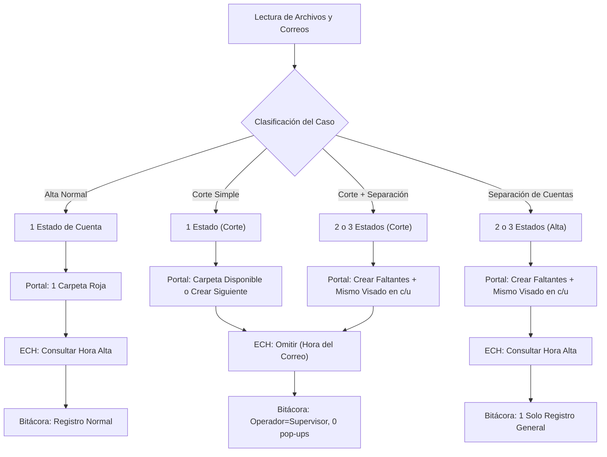

# Plan de Implementación: Digitalización de Cortes y Separaciones de Cuentas

## 1. Objetivo General
Ampliar las capacidades del Robot Digitalizador ECH para soportar dos nuevos tipos de flujos operativos además de las altas hospitalarias tradicionales:
1. **Cortes de cuenta** (facturación de montos parciales de una cuenta).
2. **Separaciones de cuentas** (múltiples estados de cuenta para un mismo paciente y episodio).

---

## 2. Comparativa de Flujos

| Característica | Alta Normal | Corte de Cuenta | Separación de Cuentas | Corte + Separación (Combinado) |
| :--- | :--- | :--- | :--- | :--- |
| **Origen / Concepto** | Alta definitiva del paciente | Monto parcial facturado | Cuenta dividida en 2 o 3 partes | Corte parcial dividido en múltiples facturas |
| **Estados de cuenta** | 1 archivo definitivo del seguro | 1 archivo (del corte) | **2 o 3 archivos válidos** | **2 o 3 archivos válidos** (del corte) |
| **Visados / Adicionales** | Se sube a su expediente | N/A o según aseguradora | Se sube **el mismo visado** a cada estado | Se sube **el mismo visado** a cada estado |
| **Portal Digitalización** | 1 carpetita roja esperada | Usa carpetita disponible; si no hay, crea la siguiente | Usa carpetita existente y **crea las faltantes** | Usa/crea tantas carpetitas como facturas compongan el corte |
| **Portal ECH** | Se consulta hora de alta | **NO aparece en ECH** (se omite) | **SÍ aparece en ECH** (se consulta) | **NO aparece en ECH** (se omite) |
| **Hora para Bitácora** | Hora de alta leída de ECH | **Misma hora del correo** | Hora de alta de ECH | **Misma hora del correo** |
| **Llamada a Paciente / Hab** | Se captura en pop-up | **No se llama** (automático N/A) | Flujo normal de alta | **No se llama** (automático N/A) |
| **Operador / Supervisor** | Operador del correo/pop-up | **Exclusivo supervisor** | Flujo normal de alta | **Exclusivo supervisor** |
| **Interacción Bitácora** | Formulario / Pop-up si falta dato | **100% automático (no pide datos)** | **1 solo registro** como alta normal | **1 solo registro** automático |

---

## 3. Diagrama de Flujo



---

## 4. Criterios de Detección e Interacción

### A. Cortes de Cuenta
- **Detección:** Se identifican en el correo mediante la palabra clave **`CORTE`** (en asunto o cuerpo).
- **Filtro de correo (`correo.py`):** Se amplía la validación del asunto para aceptar `CORTE` además de `ALTA`, marcando el objeto como `es_corte = True`.
- **Firma / Supervisor:** El correo proviene exclusivamente de un supervisor. El robot toma dicho supervisor como operador en la bitácora (`operador = supervisor`).
- **Portal ECH:** Se omite por completo la búsqueda en ECH (no son altas).
- **Hora Bitácora:** Se toma directamente la hora de envío del correo.
- **Interacción Operador:** Cero pop-ups. No se llama al paciente ni se pide captura manual de habitación.

### B. Separaciones de Cuentas
- **Detección:** Cuando existan 2 o más archivos de estado de cuenta válidos (o correos) para un mismo episodio.
- **Interacción en UI (`ui.py` / `seleccion.py`):**
  - Al detectar 2 o más archivos para el mismo episodio, el robot presenta un diálogo:
    > *"¿Es una separación de cuentas?"* (Sí / No).
  - Si el usuario selecciona **Sí**: se le despliega una lista para marcar/confirmar cuáles son los 2 o 3 archivos de estado de cuenta a digitalizar.
  - Si el usuario selecciona **No**: continúa con la lógica convencional (selecciona el definitivo y descarta los demás).
- **Digitalización en Portal:**
  - Se procesa cada uno de los 2 o 3 estados de cuenta en su correspondiente carpetita roja.
  - Para aseguradoras con visado obligatorio (ej. AXA) o reportes complementarios, **se sube el mismo archivo de visado/adicional a cada estado de cuenta**.
- **Portal ECH:** Se consulta normalmente la hora de alta.
- **Bitácora:** Se genera **un solo registro** normal de alta.

### C. Cortes con Separación (Flujo Combinado)
- **Concepto:** Es un corte de cuenta parcial que, a su vez, viene dividido en 2 o más facturas/estados de cuenta.
- **Reglas operativas:**
  - Hereda las reglas de **Corte**: Detección por palabra `CORTE`, operador = supervisor, hora del correo, omisión de ECH y cero llamadas a paciente.
  - Hereda las reglas de **Separación**: Detección de múltiples archivos, selección de los mismos, replicación de visados y digitalización en carpetitas rojas individuales para cada parte.
- **Bitácora:** Genera **un solo registro** automático con los datos del corte.

---

## 5. Procedimiento para la Creación Dinámica de Carpetitas Rojas

Cuando se busca el episodio en el portal principal (`noExpediente` + `envioEpisodio`), se muestra una tabla donde cada fila `<tr>` representa un episodio/cuenta y posee un `id` numérico secuencial (`id="0"`, `id="1"`, `id="2"`, etc.).
Dentro de cada `<tr>` se encuentra la carpetita roja (icono `//img[@title='Abrir']`).

### A. Regla Fundamental de Validación Previa (Evitar Crear Carpetas Innecesarias)

Antes de disparar la creación de una nueva carpetita roja, el robot ejecuta una inspección previa para determinar si ya existen carpetas utilizables:

1. **Separación de Cuentas (N facturas / estados de cuenta):**
   - **Conteo previo:** El robot cuenta cuántas carpetitas rojas ($M$) existen actualmente en la tabla del episodio (`id="0"`, `id="1"`, etc.).
   - **Si $M \ge N$ (Carpetas suficientes):** Por ejemplo, es una separación de 2 estados de cuenta y al entrar ya hay 2 o más carpetitas rojas creadas. **NO se crea ninguna carpeta adicional**; se procede directamente a digitalizar cada archivo en las carpetitas existentes.
   - **Si $M < N$ (Faltan carpetas):** Por ejemplo, se requieren 2 cuentas y solo existe 1 ($M = 1, N = 2$). El robot creará únicamente las $N - M$ carpetitas faltantes antes de digitalizar.

2. **Corte de Cuenta Simple (1 estado de cuenta):**
   - **Inspección de la última carpetita:** En cortes puede haber 1, 2, 3 o más carpetitas previas de días o cortes anteriores. El robot abre siempre la **última carpetita roja creada** (la fila de mayor índice).
   - **Validación de disponibilidad para digitalizar:**
     - El robot evalúa la fila `"estado de cuenta"`. Si dicha fila cuenta con el campo de carga `<input type="file">` disponible y **NO** tiene el icono de confirmación `y.png`, significa que la carpetita está abierta y libre.
   - **Resultado de la validación:**
     - **Si se puede digitalizar (libre):** Digitaliza el corte directamente en esa última carpetita. **No crea una nueva**.
     - **Si NO se puede digitalizar (ocupada/ya digitalizada):** El robot regresa a la búsqueda del episodio, ejecuta la creación de la siguiente carpetita roja en la secuencia, la abre y digitaliza en la nueva.

3. **Cortes con Separación (Flujo Combinado):**
   - El robot valida primero si la última carpetita roja existente está disponible para digitalizar.
   - Si la última está disponible, se aprovecha para una de las facturas del corte.
   - Determina cuántas carpetitas adicionales se requieren para cubrir el total de facturas del corte y crea únicamente las faltantes.

### B. Secuencia de Automatización en el Portal (`portal.py`)
Para crear una nueva fila / carpetita roja:

1. **Lectura del Código de Aseguradora Activa:**
   - En la tabla de resultados actual, se lee el texto de la columna **Cuenta** (correspondiente al tercer `<td>` de la fila activa).
   - Se extrae el código o identificador de la aseguradora para replicarlo en la nueva cuenta.
2. **Selección del Servicio:**
   - Localizar el selector de servicio:
     ```html
     <select class="form-control" id="servicio" required="">
       <option id="6" value="6">Hospitalización</option>
     </select>
     ```
   - Seleccionar la opción **"Hospitalización"** (`value="6"` / `id="6"`).
3. **Iniciar el Proceso de Creación:**
   - Hacer clic en el botón de inicio:
     ```html
     <input id="envio" class="btn btn-success btn-lg" value="Iniciar">
     ```
4. **Selección de la Aseguradora:**
   - Esperar a que se habilite o aparezca el selector de aseguradora:
     ```html
     <select id="asegurador">
     ```
   - Seleccionar la aseguradora coincidente mediante el código obtenido previamente en el paso 1.
5. **Crear y Confirmar:**
   - Hacer clic en el botón:
     ```html
     <button id="nuevo" class="btn btn-success btn-lg">Nuevo</button>
     ```
   - Manejar la alerta del navegador (alerta de confirmación "¿Está seguro?"):
     ```python
     alert = driver.switch_to.alert
     alert.accept()
     ```
6. **Verificación y Continuación:**
   - Esperar a que la tabla se actualice y aparezca la nueva fila `<tr>` con el `id` subsiguiente (ej. `id="1"`, `id="2"`).
   - Ubicar la nueva carpetita roja (`//img[@title='Abrir']`) dentro de ese nuevo `<tr>`.
   - Abrirla y proceder con la digitalización de los documentos correspondientes.

---

## 6. Componentes Involucrados en el Código

1. **`modelos.py`**:
   - Atributos o enumeración de tipo de proceso: `ALTA`, `CORTE`, `SEPARACION`, `CORTE_SEPARACION`.
   - Soporte en `Tarea` para contener listas de archivos a digitalizar por cuenta.

2. **`correo.py`**:
   - Identificación de `CORTE` en asunto o cuerpo del mensaje.
   - Extracción de supervisor y asignación como operador.

3. **`seleccion.py`**:
   - Detección de múltiples estados de cuenta y diálogo interactivo para confirmar si es separación y seleccionar los 2 o 3 archivos.

4. **`portal.py`**:
   - Funciones de inspección y validación: `contar_carpetas_existentes()`, `abrir_ultima_carpeta()` y `puede_digitalizar_estado_cuenta()` (verifica que `input[@type='file']` esté libre y sin `y.png`).
   - Función `crear_carpetita_roja(codigo_asegurador=None)` implementando los pasos de servicio 6 (Hospitalización), botón `#envio`, select `#asegurador`, botón `#nuevo` y confirmación de alerta.
   - Gestión inteligente de carpetas: apertura de existentes, validación previa en cortes y creación únicamente de las carpetitas faltantes.
   - Replicación de visados en todas las carpetas del episodio en separaciones.

5. **`robot.py`**:
   - Coordinación de flujos: desvío de ECH en cortes, bitácora unificada y orquestación del ciclo de subida múltiple.
