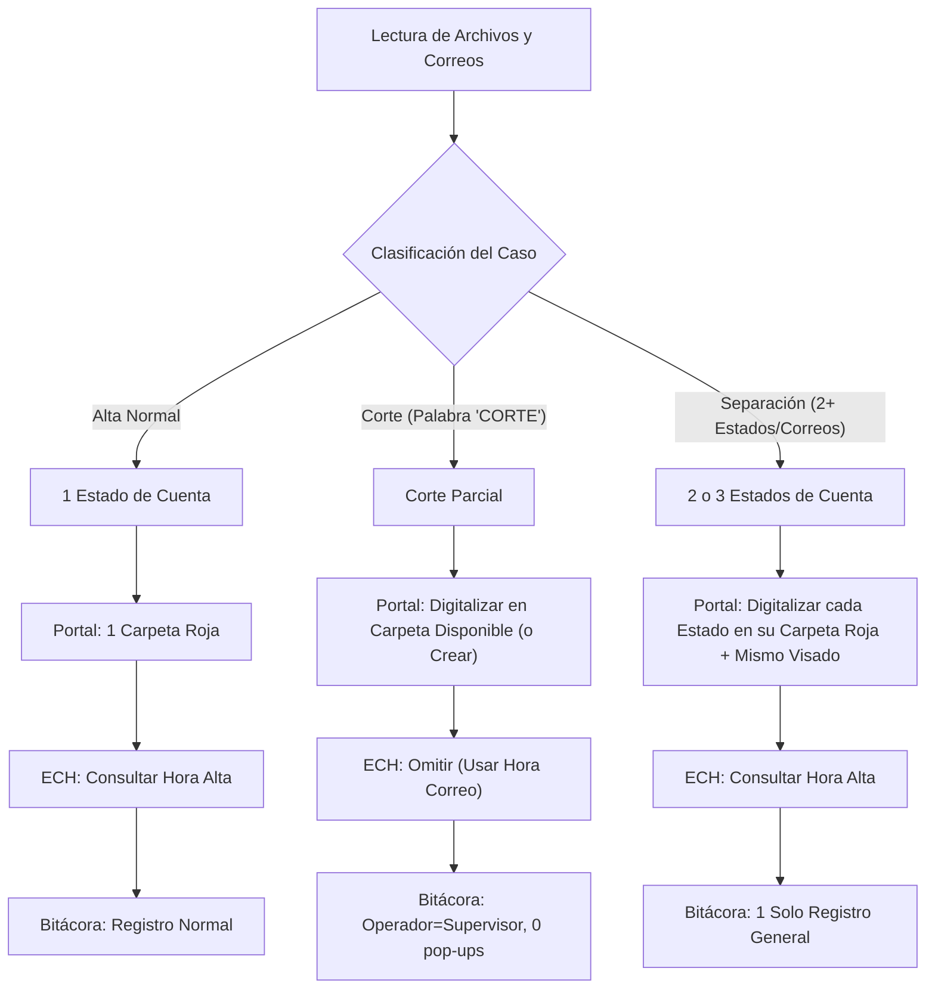

# Plan de Implementación: Digitalización de Cortes y Separaciones de Cuentas

## 1. Objetivo General
Ampliar las capacidades del Robot Digitalizador ECH para soportar dos nuevos tipos de flujos operativos además de las altas hospitalarias tradicionales:
1. **Cortes de cuenta** (facturación de montos parciales de una cuenta).
2. **Separaciones de cuentas** (múltiples estados de cuenta para un mismo paciente y episodio).

---

## 2. Comparativa de Flujos

| Característica | Alta Normal | Corte de Cuenta | Separación de Cuentas |
| :--- | :--- | :--- | :--- |
| **Origen / Concepto** | Alta definitiva del paciente | Monto parcial facturado | Cuenta dividida en 2 o 3 partes |
| **Estados de cuenta** | 1 archivo definitivo del seguro | 1 archivo (del corte) | **2 o 3 archivos válidos** |
| **Visados / Adicionales** | Se sube a su expediente | N/A o según aseguradora | Se sube **el mismo visado** a cada estado de cuenta |
| **Portal Digitalización** | 1 carpetita roja esperada | Múltiples carpetitas rojas (subir en la disponible; crear si no hay) | Múltiples carpetitas rojas (subir a cada una; crear si faltan) |
| **Portal ECH** | Se consulta hora de alta | **NO aparece en ECH** (se omite búsqueda) | **SÍ aparece en ECH** (se consulta normal) |
| **Hora para Bitácora** | Hora de alta leída de ECH | **Misma hora del correo** | Hora de alta de ECH |
| **Llamada a Paciente / Hab** | Se captura en pop-up | **No se llama** (automático N/A) | Flujo normal de alta |
| **Operador / Supervisor** | Operador del correo/pop-up | **Exclusivo supervisor** (Operador = Supervisor en bitácora) | Flujo normal de alta |
| **Interacción Bitácora** | Formulario / Pop-up si falta dato | **100% automático (no pide datos)** | **1 solo registro** como alta normal |

---

## 3. Diagrama de Flujo

---

## 4. Criterios de Detección e Interacción

### A. Cortes de Cuenta
- **Detección:** Se identifican en el correo mediante la palabra clave **`CORTE`** (en asunto o cuerpo).
- **Filtro de correo (`correo.py`):** Se amplía la validación del asunto para aceptar `CORTE` además de `ALTA`, marcando el objeto como `es_corte = True`.
- **Firma / Supervisor:** El correo proviene exclusivamente de un supervisor. El robot toma dicho supervisor como operador en la bitácora (`operador = supervisor`).
- **Portal ECH:** Se omite por completo la búsqueda en ECH (no son altas).
- **Hora Bitácora:** Se toma directamente la hora de envío del correo.
- **Interacción Operador:** Cero pop-ups. No se llama al paciente ni se pide captura manual de habitación.

### B. Separaciones de Cuentas
- **Detección:** Cuando existan 2 o más archivos de estado de cuenta válidos (o correos) para un mismo episodio.
- **Interacción en UI (`ui.py` / `seleccion.py`):**
  - Al detectar 2 o más archivos para el mismo episodio, el robot presenta un diálogo:
    > *"¿Es una separación de cuentas?"* (Sí / No).
  - Si el usuario selecciona **Sí**: se le despliega una lista para marcar/confirmar cuáles son los 2 o 3 archivos de estado de cuenta a digitalizar.
  - Si el usuario selecciona **No**: continúa con la lógica convencional (selecciona el definitivo y descarta los demás).
- **Digitalización en Portal:**
  - Se procesa cada uno de los 2 o 3 estados de cuenta en su correspondiente carpetita roja.
  - Para aseguradoras con visado obligatorio (ej. AXA) o reportes complementarios, **se sube el mismo archivo de visado/adicional a cada estado de cuenta**.
- **Portal ECH:** Se consulta normalmente la hora de alta.
- **Bitácora:** Se genera **un solo registro** normal de alta.

---

## 5. Componentes Involucrados en el Código

1. **`modelos.py`**:
   - Enumeración o atributo de tipo de proceso: `TipoProceso.ALTA`, `TipoProceso.CORTE`, `TipoProceso.SEPARACION`.
   - Soporte en `Tarea` para contener la lista de documentos a digitalizar en separaciones.

2. **`correo.py`**:
   - Soporte para identificar `CORTE` en el asunto/cuerpo.
   - Extracción de supervisor y asignación a operador.

3. **`seleccion.py`**:
   - Detección de múltiples candidatos y consulta interactiva para separaciones.
   - Retención de los 2 o 3 archivos seleccionados por el operador.

4. **`portal.py`**:
   - Gestión de múltiples resultados/carpetitas rojas en el portal principal.
   - Apertura de la carpeta disponible en cortes.
   - Apertura secuencial de carpetas para separaciones.
   - Inyección replicada de visados y resúmenes.
   - *(Pendiente)* Creación de carpetitas rojas cuando no existan.

5. **`robot.py`**:
   - Orquestación de saltos condicionales (omitir ECH en cortes; 1 solo registro de bitácora en separaciones).
   - Generación automática de datos de bitácora para cortes sin pop-up.

---

## 6. Siguiente Fase (Pendiente)
- Definición e implementación del flujo exacto para la **creación de carpetitas rojas** en el portal de expedientes cuando ninguna esté disponible.
